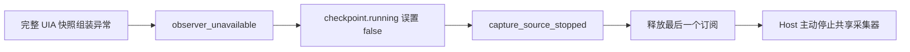

# Teach Mode Windows 录制失败根因与计时条修复

2026-10-20，在业务源码基线 `0af001d193efe5aecafc2bc4d0f40ba03e883e31` 上复现并修复。插件仍使用独立仓库 Teach Mode `0.3.0` 的固定 Windows CI ZIP，SHA-256 为 `d3c388a20c85658c6be54f5e1977d871b9b9141f0e2bb7b94ee4018f01485eb3`。这次修改均在 Host，未更改插件包或正式云端配置。

## 结论

录制失败由两个问题叠加：Windows PowerShell 5.1 在组装完整 UIA 快照时抛异常，Host 又把可恢复的观察器故障当成采集进程已停止，随后主动释放了最后一个采集订阅。此前看到的 `capture_source_stopped` 是这条链路最终对会话报告的错误，不能据此认定原生进程先崩溃。

修复后，同一 Windows 原生链路持续采集 30 秒并保存 6 条事件；真实 Memmy 对话会话持续约 193 秒，结束时有 11 条事件，状态为 `ready / available`，实际文件 SHA-256 与会话元数据一致。新计时条在实际对话中从 `00:01` 递增至 `00:07`，结束后固定为 `03:12`。

## 直接故障：完整快照的泛型列表转换

`App/native-computer-history/apps/OpenComputerHistoryWindows/worker.ps1` 的 `Snapshot` 创建 `System.Collections.Generic.List[object]` 存放已验证的点击目标，原先用 `targets=@($targets)` 组装结果。

在本机 Windows PowerShell 5.1 中，这个转换会触发 `System.ArgumentException`。为排查，临时诊断副本只记录异常类型、错误代码和脚本行号，不记录异常消息或观察内容。8 次真实 UIA 请求中，6 次完整快照进入同一异常分支；调用栈指向修改前的 `Snapshot` 第 256 行。非完整观察仍可能成功，所以会先看到 `observer_ready` 和 `application_changed`，随后完整快照连续失败并产生 `observer_unavailable`。

修复将结果组装集中到 `SnapshotResult`，显式调用 `$targets.ToArray()`。同一个真实 Windows UIA 探针复测后，完整请求返回非空快照，未再发生该异常。PowerShell 5.1 自检新增空列表和非空列表的实际序列化回归，并接入 Host Windows CI。

此前的受控事件测试没有执行真实 UIA 快照组装；原有原生纯自检主要覆盖协议、来源校验及调度，也没有覆盖这一泛型列表转换。这解释了受控测试通过而真实桌面采集失败的差异。

## 放大故障：把覆盖质量当作采集进程生命周期

`ComputerHistoryDemoService.eventCheckpoint()` 原先只有在 `captureObserverReadyAt > 0` 且不存在 `observer_unavailable` 等问题时，才返回 `running: true`。`PluginEventSessions.collect()` 收到 `running: false` 就会将会话标记失败，并释放订阅。

Windows 诊断时间线（UTC）说明了实际先后关系：

| 时间 | 观察 |
| --- | --- |
| 14:06:53.068 | 收到采集心跳 |
| 14:06:54.153 | 收到 `observer_ready` |
| 14:06:54.176 | 教学会话进入 `recording` |
| 14:06:58.888 | 收到 `observer_unavailable` |
| 14:07:06.308 | 采集子进程仍存活，健康状态为 degraded |
| 14:07:06.927 | 教学会话被标记为 `capture_source_stopped` |
| 14:07:07.307 | 释放订阅后，采集子进程已退出 |

同一判定还会导致另一种启动失败：当前窗口暂时不可读或浏览器普通窗口身份无法确认时，还没有 `observer_ready`，即使进程仍在工作，也可能返回 `capture_not_running`。隐私规则要求跳过的窗口继续跳过；它们不会因此获得采集授权。

修复后，`running` 根据订阅、Host 状态和真实子进程退出状态判断。观察器就绪、健康问题和 native→disk 边界用来判断完整性：未确认时保留 `partial` 与限制说明；真正停止、退出或撤销订阅仍返回非运行状态。录制期间出现过的不完整边界，在恢复后也不会被覆盖为完整片段。

共享采集仍保留用户的后台 Computer History 意图。测试时后台意图为 stopped，插件临时取得采集订阅；最后一个订阅释放后恢复 stopped。这是预期行为。

## 窗口录制计时条

`PluginConversationRecording` 在对话输入框上方显示独立录制条，复用现有录制条样式：视频图标、红色录制标记、按真实 `startedAt` 计算的时长，以及结束、取消、停用操作。

- `/teach` 仅待命时不显示活动计时。
- 实际会话进入录制后，每秒更新；超过一小时显示 `HH:MM:SS`。
- 结束请求处理中显示处理状态；结束后按真实 `endedAt` 固定时长并撤下活动条。
- 部分可用时显示覆盖提示，失败时显示真实错误，不保留活动录制样式。
- 会话切换只展示当前对话的状态；结束和取消均不会自动生成技能。

该计时条表示已授权桌面操作事件采集；本次没有新增屏幕视频或音频采集。

## 验证

| 检查 | 结果 |
| --- | --- |
| 采集健康、重连、暂停/恢复、共享订阅、边界、插件会话 | 120 项通过 |
| 对话计时条、插件商店及录制可见性 | 30 项通过 |
| Agent 编译、renderer 类型检查与生产构建 | 通过 |
| Go 原生观察器测试 | 通过 |
| Windows PowerShell 5.1 空/非空快照目标序列化 | 通过 |
| Windows 原生采集前后对照 | 修复前约 12.8 秒失败、0 条事件；修复后 30 秒结束、6 条事件，`ready / available` |
| 真实 Memmy 对话 | 单独待命与明确开始；模型实际调用本地插件；计时递增、UI 结束、时长冻结、落盘哈希核验通过 |

真实 Memmy 会话：`5a237049-b30c-4fc6-93f2-66e3bbef7a9f`；对话：`47da2c82-bc98-4898-bada-41c0600f441e`；起止时间：`2026-10-20T14:25:01.117Z` → `2026-10-20T14:28:14.089Z`。11 条事件为 8 条可访问性快照和 3 条应用变化，包含公开诊断文本。证据哈希：`ed2bc49398c7f4fcc4e3e0e01316b18c432016c74d1841e7bb4a6c29ad0eb519`。

本机证据保存在 `/home/zephyr/work/teach-mode-recording-fix-20261020/evidence/`：`before-trace.jsonl`、`uia-trace.jsonl`、`after-trace.jsonl`、`worker-selftest-result.json`、`live-result.json`、`ended-result.json`、`file-verification.json` 及 `screenshots/`。截图和运行数据留在本机，未上传到仓库；运行密钥与配置不进入报告。

## 仍需单独处理的事项

真实对话复测前，仍需通过重新安装恢复已知的 Windows 插件初始化时序问题，并重连 Gateway 刷新插件工具。首次模型调用误用了 Composio 搜索，重连并明确重试后，实际调用的是 `mcp_plugins_plugin_record_and_replay_cb7d2519`。快速确认安装权限还暴露了现有界面的操作锁竞态，等待安装操作完成后再次确认可恢复。这些启动与安装问题不在本次采集器和计时条修复内。

本次验收覆盖采集、计时条及结束落盘。论文完整示范、生成 skill 和第 2–5 条复用仍需后续完整重验；此前端到端失败报告继续保留。正式云端 Registry、catalog、下载和更新入口仍留空。
